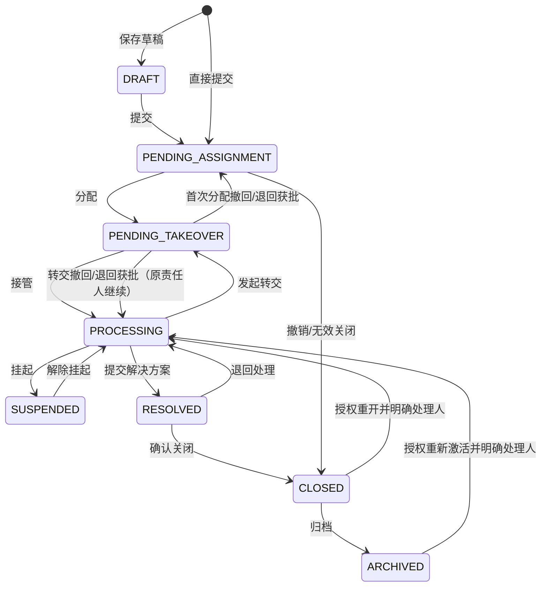

# 事件管理需求说明书

| 项目 | 内容 |
| --- | --- |
| 文档版本 | v1.1 草案 |
| 编写日期 | 2026-10-11 |
| 状态 | 待业务评审，可作为开发拆解依据 |
| 关联文档 | 《产品设计文档》《产品设计文档-精简版》《部门管理需求清单》 |
| 模块入口 | 工单管理 → 事件管理 |
| 目标 | 建立可分配、可协作、可移交、可追溯的事件处理闭环 |

本文细化用户已提出的事件分配、转发、转交、状态及生命周期记录要求。工单分派仅允许服务台角色执行，此项为已确认要求。接管确认、解决确认、归档条件等补充规则为建议默认方案，待评审后作为业务基线。本文描述目标需求，不代表这些功能已经实现。

## 1. 业务范围与现状

事件指影响或可能影响 IT 服务正常运行、需要人员跟进处理的问题，例如网络故障、系统不可用、设备异常、账号访问异常。

项目已有统一工单类型 `INCIDENT`、前端工单原型和后端接口骨架；后端尚未形成事件持久化及完整动作闭环。新增独立“事件管理”页面，业务上复用统一工单主干，以 `type=INCIDENT` 标识事件，不与服务请求、问题、变更重复建单。

第一期包含：创建、查询、详情、分配、接管、处理意见、转发协作、转交责任、挂起、解决、确认关闭、归档、完整时间线、站内通知和权限校验。事件及记录必须保存在数据库，刷新页面或重启服务不丢失。

后续范围：邮件自动建单、短信/即时通信通知、自动分派、批量动作、工作日历、自动归档、外部接收人、事件关联问题/变更及复杂审批。第一期仍保留相关扩展空间。

## 2. 核心概念和责任边界

| 概念 | 发起人 | 接收人义务 | 责任人变化 | 主状态变化 |
| --- | --- | --- | --- | --- |
| 分配 | 仅服务台角色（`SEAT`） | 被分配人必须接管、处理、提交处理意见 | 首次分配进入等待接管，接受后成为责任人 | 待分配 → 待接管 → 处理中 |
| 转发 | 当前处理人或服务台 | 可查看事件、回复协作意见；默认不要求必须回复 | 不变 | 不变 |
| 转交 | 当前处理人或服务台 | 目标人必须确认接管并承担处理任务 | 接受前仍是原责任人，接受后切换 | 处理中 → 待接管 → 处理中 |
| 处理意见 | 当前处理人 | 记录分析、处理过程和结果 | 不变 | 普通意见不改变状态 |
| 解决 | 当前处理人 | 必须提供解决方案及处理结果 | 不变，等待确认 | 处理中 → 已解决 |
| 归档 | 服务台或授权管理员 | 确认结案资料齐全 | 保存历史责任人 | 已关闭 → 已归档 |

每个事件同一时刻最多一个当前责任人。转发接收人可以有多个；同一时刻最多一个待接管对象。处理部门以分配时选定部门为准，责任人必须属于该部门且为启用用户。历史部门、姓名发生变化不覆盖当时记录。分配、转发、转交需要可以选择人员跟角色（均为可多选）

“接管人必须处理”指：接受后产生必办任务，不能仅回复协作意见就完成任务；必须提交处理意见和最终处理结果，或经过有效转交移出责任。系统不以强制点击代替实际处理。
事件需要增加草稿状态，此状态只可申请人查看，草稿状态的事件单可修改、可再次提交。
事件管理需要可检索，可根据时间、内容、主题、类型、状态、申请人等检索。

## 3. 角色与权限

| 角色/关系 | 可见范围 | 主要操作 |
| --- | --- | --- |
| 创建人 | 自己创建的事件 | 创建、查看、补充说明、解决确认、退回处理 |
| 服务台坐席 | 授权数据范围内事件 | 分配、转发、转交、催办、关闭、归档 |
| 当前处理人 | 自己负责的事件 | 接管后处理、转发、转交、挂起、解决 |
| 待接管人 | 分配/转交给自己的事件 | 查看、接管；符合规则时申请退回 |
| 转发接收人 | 转发给自己的事件 | 查看允许的事件资料、回复协作意见 |
| 历史处理人 | 自己曾处理过的事件 | 查看历史及后续进展；不自动保留处理权 |
| 管理者/审计人员 | 授权部门或全局 | 只读查询、统计、生命周期审计 |
| 系统管理员 | 全部事件 | 管理及异常纠正；不自动获得分派权，兼具服务台角色才可分派；纠正也必须留痕 |

权限规则：菜单/接口权限和事件关系、数据范围同时校验。不能仅凭知道事件编号访问事件；转发或转交建立的关系授予必要查看/回复权限，不授予分配、删除、修改基础信息的权限。正常业务按钮对拥有事件入口权限的参与人开放，基础查看及回复权限随业务角色预置，避免收到通知却无法访问。

**分派角色硬性约束（已确认）**：只有具有启用的服务台角色（角色编码 `SEAT`）的用户可以分派工单，包括首次分配、重新分配以及通过管理纠正或重开流程指定新的接管人。还须具有 `itsm:incident:assign` 操作权限，且事件在其数据范围内、当前状态允许分配。单独授予分派权限点不能代替服务台角色；仅有 `ADMIN`、工程师、管理者或创建人身份均不能分派。多角色用户只要同时满足服务台角色及上述权限条件即可分派。

后端必须对分派相关接口额外校验服务台角色，不能被现有 `ADMIN` 权限直通机制绕过；前端同样按服务台角色显示分派按钮。非服务台用户直接调用接口返回无分派权限，不更新责任人、状态或业务流转记录。管理员如需分派，应先按组织授权流程取得服务台角色。

“转交”仍按当前处理人或服务台的责任移交规则执行，不视为服务台首次分派；不得通过修改事件字段、管理纠正、重开等其他接口绕过分派角色约束。

建议权限点：`itsm:incident:list/detail/create/edit/assign/forward/transfer/accept/comment/suspend/resolve/close/archive/reopen/audit`。接口逐项鉴权；转发回复与处理意见必须分别校验对应身份。接收人选择接口只返回必要人员资料，支持姓名、邮箱、手机号检索，不依赖用户管理权限。

已归档事件禁止一般修改。事件不提供物理删除；撤销、无效关闭、归档均留存记录。人员停用后禁止登录和新分配；未完成责任任务由服务台重新分配，不能静默清除。归档事件可以查看跟再次转发。

## 4. 事件信息

### 4.1 基础字段

| 字段 | 规则 |
| --- | --- |
| 事件编号 | 系统自动生成，如 `INC-20261011-000001`；唯一且不可修改 |
| 标题 | 必填，1～200 字，去除首尾空格 |
| 事件描述 | 必填，1～10000 字，说明现象、影响和发生背景 |
| 分类 | 必选，初期使用可维护字典，如网络、系统、设备、账号、其他 |
| 来源 | 门户/服务台代录/API；记录实际创建人及报告人 |
| 影响度、紧急度 | 必选；沿用项目优先级矩阵，生成 P1～P4 建议值 |
| 优先级 | 可由授权人员调整，调整原因必填并留痕 |
| 报告人、报告部门 | 默认当前用户；服务台可代录，代录不改变实际创建人 |
| 发生时间 | 可选，不允许晚于提交时间；未知时不填写 |
| 附件 | 可选；建议单文件最大 20MB、每次最多 10 个；白名单及总配额由系统配置 |
| 处理部门 | 分配前可为空；分配、转交时必选 |
| 当前处理人 | 最多一人，不能通过普通编辑直接变更 |
| 待接管人 | 分配/转交请求有效期间记录目标人 |
| 状态 | 系统按动作流转，禁止普通字段接口任意修改 |
| 创建人/时间、更新时间 | 系统生成，创建信息不可覆盖 |
| 解决、关闭、归档时间和操作人 | 对应动作成功时记录 |
| 响应/解决期限 | 按优先级策略计算；转交不重置总期限 |

负责人是事件当前责任人，与部门负责人独立。员工选择以用户 ID 为准，禁止以姓名作为唯一标识；所有数据库长编号经 API 使用字符串，防止浏览器数字精度丢失。

### 4.2 意见类型

- 补充说明：创建人补充事实或材料，不可作为结案依据。
- 协作意见：转发接收人回复建议、核查结果，可携带附件；不代表接管或解决。
- 处理意见：当前处理人记录过程；首次接受任务之后至少提交一条，才可解决或再次转交。
- 解决方案：必须填写原因分析、采取措施、处理结果和验证说明，不可仅填“已处理”。
- 关闭/归档说明：确认结案、无效关闭或归档时记录依据。

意见提交后不允许直接覆盖或删除；错误通过补充说明纠正，并关联原记录。

## 5. 状态与流转

### 5.1 状态定义

| 编码 | 中文 | 定义 | 允许的主要动作 |
| --- | --- | --- | --- |
| `DRAFT` | 草稿 | 未正式提交，未启动时限 | 修改、提交、删除自己的草稿 |
| `PENDING_ASSIGNMENT` | 待分配 | 正式提交但没有待接管任务 | 分配、补充说明、撤销/无效关闭 |
| `PENDING_TAKEOVER` | 待接管 | 首次分配或责任转交已发起 | 接管、催办、撤回、退回申请、协作回复 |
| `PROCESSING` | 处理中 | 责任人已接管，承担处理义务 | 处理意见、转发、转交、挂起、解决 |
| `SUSPENDED` | 已挂起 | 等待外部条件，须记录原因 | 回复、解除挂起；转交前先解除挂起 |
| `RESOLVED` | 已解决 | 已提交方案，等待创建人确认 | 确认关闭、退回处理、协作回复 |
| `CLOSED` | 已关闭 | 正常确认结束，或撤销/无效关闭 | 归档；授权重开 |
| `ARCHIVED` | 已归档 | 完成留存，禁止一般写操作 | 查看、审计；特殊权限重新激活 |

建议沿用统一工单框架，但显式增加待分配、待接管、已归档状态。现有 `PENDING`、`ACCEPTED` 不应直接猜测映射：迁移需根据是否存在责任人和待接管任务制定规则，异常记录由服务台核对。

转发和协作回复不改变主状态。待接管期间首次分配没有责任人，由服务台负责催办；转交期间原责任人继续负责响应和风险控制，但不得解决、再次转交或挂起事件，须先撤回待接管请求。重开时如历史处理人已停用，必须选择新的有效处理人并重新走待接管流程。

## 6. 动作规则

### 6.1 创建与分配

1. 创建人录入基础信息，可保存草稿或正式提交。草稿仅创建人及审计授权人员可见。
2. 提交生成事件编号、创建记录、待分配状态并启动计时；草稿不计时。
3. 仅具有服务台角色（`SEAT`）并通过分派权限校验的用户选择处理部门和一名启用用户，填写分配说明。支持按姓名、邮箱、手机号查找、显示部门和账号区分同名人员。
4. 分配后进入待接管，目标人收到必办通知；目标人接受后立即进入处理中并记录首次响应时间。
5. 首次分配撤回由服务台执行并回到待分配。重新分配同样仅限服务台角色，产生新记录，旧请求失效；不能覆盖原分配记录。

### 6.2 转发协作

1. 服务台或当前处理人选择一至多名内部启用用户，填写转发原因/希望协助事项，附件可选。
2. 可用于待分配、处理中、已挂起、已解决状态；待接管期间原责任人和服务台可转发。
3. 接收人获得当前事件可见资料、后续一般处理进展及自己的协作线程访问权。默认不开放其他接收人的独立协作回复、内部受限资料及管理审计信息。
4. 每次转发建立独立协作线程。记录发起人、接收人、原因、时间、已读时间、回复及附件。
5. 一次请求中接收人去重，不能转发给自己。再次向同一人转发允许，但要求新的说明并保留独立记录。
6. 接收人可多次回复；不回复不阻止解决或归档。若希望强制协作回复，列为后续可配置要求。
7. 接收人不能通过转发取得处理、再分配、转交、关闭权限，也不能再次转发扩散事件。
8. 转发可撤回，撤回后不能继续回复，保留已有回复及审计；仅靠该线程获得的访问权终止。若用户还有其他有效事件关系，保留该关系对应访问权。

### 6.3 转交责任

1. 当前处理人或服务台在处理中发起转交；选一名目标处理人及部门，转交原因、当前进展、未完成事项必填。
2. 原处理人主动转交前至少提交一条本次接管后的处理意见。服务台异常接管纠正可例外，但原因必填并单独审计。
3. 进入待接管，保存原责任人和目标人。目标人可查看历史处理资料，并获得必须确认的待办任务。
4. 目标人点击“接管”后责任人切换、状态回到处理中，原处理人待办结束，生成新的责任区间。
5. 禁止无理由拒绝。目标人可提交“申请退回”及原因，由服务台审批；审批前请求仍待接管。获批后恢复原处理人，首次分配则回到待分配。
6. 原发起人或服务台可在接管前撤回。接管后不可撤回，只能发起新的转交。
7. 不能转交给自己、停用/删除人员或不属于目标部门的人员。目标人在请求发起后被停用时，接管校验失败并提示服务台重分配。
8. 同一事件不允许同时存在两个待接管任务；超时不自动视为接受，不自动免除原责任人的责任。
9. 每次接管后的处理意见和处理耗时独立统计；所有历史处理人及责任区间完整保留。

### 6.4 解决、关闭、归档与重开

- 解决：仅当前处理人操作；不存在待接管任务；处理意见和解决方案完整，进入已解决。
- 确认关闭：创建人确认服务恢复后关闭；服务台可代为确认，代确认原因必填。创建人认为未恢复时提交原因退回处理中，不创建新事件。
- 无效关闭：仅待分配允许创建人撤销或服务台判定无效，原因必填；已处理中事件不能绕过处理流程直接无效关闭。
- 归档：仅已关闭事件可操作；没有未完成责任任务，生命周期及解决/无效关闭依据完整。开放协作线程标记结束，不要求所有接收人回复。记录归档人、时间和说明。
- 归档后：信息、意见、附件关联均只读；不能通过旧页面或直接调用接口继续写入。
- 重开/重新激活：创建人提交申请，服务台或管理员执行；原因必填，明确有效处理人；若需要指定新的接管人，必须由服务台角色分派，管理员不能单独完成此动作；保留原关闭/归档记录，增加新的处理周期。
- 第一期开关单采用人工确认；自动关闭、自动归档作为后续策略配置。

## 7. 生命周期记录与审计

### 7.1 记录清单

必须记录：草稿提交、创建、基础信息修改、优先级调整、分配、分配撤回、首次接管、转发、转发查看、协作回复、转发撤回、转交发起、接管、退回申请/审批、转交撤回、处理意见、挂起/恢复、解决、退回处理、关闭、归档、重开、管理纠正、附件添加。

| 通用字段 | 说明 |
| --- | --- |
| 事件 ID、记录 ID、动作编码 | 唯一关联；记录追加不可覆盖 |
| 操作人 ID、姓名/部门快照 | 服务端身份，防止冒用；保留历史展示 |
| 服务端时间、事件内递增序号 | 统一排序；同一时间按序号展示 |
| 动作前/后状态 | 不改变状态的动作也保存当时状态 |
| 原/目标责任人、原/目标部门 | 分配及转交必填相关字段 |
| 原/新值 | 基础信息变更记录差异，不重复保存无变化字段 |
| 原因、意见、附件引用 | 与动作、协作线程、责任任务绑定 |
| 处理周期、请求/线程关联 ID | 关联同一次发起、接受、撤回或回复 |
| 请求幂等键 | 防止重复点击产生重复动作 |

创建记录不可被修改时间覆盖。多人、多次转发/转交分别记录；不能只保留最后处理人。业务状态变更和对应审计记录同一事务提交，失败不产生部分成功记录。通知发送失败不回滚已成功的业务动作，由重试机制补发。

时间线展示“谁在什么时候对谁做了什么、原因/意见是什么、状态如何变化”，支持按动作和处理人过滤。一般用户按资料可见性展示，完整管理审计仅审计权限可见。转发阅读留痕记录首次阅读时间，重复阅读不刷屏；一般详情访问记录可进入单独访问审计。

### 7.2 责任区间

记录每位处理人的接管时间、离开责任时间、进入/离开原因、处理意见、解决方案及处理周期。转交发起至目标接受期间仍计入原责任人的区间。挂起时间单独记录，不与自然耗时混淆。

## 8. 页面与交互

### 8.1 事件列表

- 搜索：事件编号/标题关键词；筛选分类、状态、优先级、创建人、处理部门、处理人、创建时间区间、是否超时。
- 页签：全部（权限范围）、我创建的、待我接管、我处理的、转发给我的、我曾处理的、已归档。
- 列：编号、标题、状态、优先级、创建人、处理部门、当前处理人、待接管人、创建时间、更新时间、时限/超时标识。
- “查询”按钮应用筛选；“重置”清空筛选；分页默认 20 条。切换筛选回到第一页。
- “新增事件”进入创建页。批量操作第一期不提供。

### 8.2 事件详情

顶部显示编号、标题、状态、优先级、当前处理人、待接管人和超时提示。内容分为基础信息、处理信息、协作记录、责任流转、生命周期。

处理信息提供处理意见列表、当前周期解决方案；协作记录按转发线程展示接收人、已读/已回复状态；责任流转展示每次分配/转交和接管情况；生命周期展示统一时间线。

动作按钮随权限和状态显示；不适用动作说明原因，例如“待接管请求尚未结束，请先撤回”。分配/转发/转交均采用员工检索选择，不允许自由输入姓名代替人员 ID。提交后刷新状态、任务和时间线；旧页面动作遇到版本冲突应提示刷新。

### 8.3 对话框和工作待办

- 分配：部门、处理人、角色、分配说明。
- 转发：多选接收人、协助事项、附件；说明“接收人可查看并回复，责任人不变”。
- 转交：目标部门/人员/角色、原因、进展、未完成事项；说明“目标接受前仍由当前处理人负责”。
- 接管：展示来源、移交内容，确认后生成处理待办。
- 回复：明确标注“协作意见”或“处理意见”，不得混用。
- 解决：原因分析、措施、结果、验证说明。
- 归档：结案摘要、归档说明、确认按钮。
- 工作台展示待接管、待处理、协作未读、待确认解决数量及入口，数字以服务端为准。

## 9. 通知与计时

| 触发 | 接收人 | 待办类型 |
| --- | --- | --- |
| 正式创建 | 服务台 | 待分配 |
| 分配/转交 | 目标人 | 必须接管 |
| 接管 | 原处理人/分配人、创建人 | 进展通知；目标人新增处理待办 |
| 转发 | 每位接收人 | 协作通知 |
| 协作回复 | 转发发起人、当前处理人 | 回复通知，去重发送 |
| 退回申请 | 服务台 | 退回审批 |
| 提交解决 | 创建人 | 确认解决 |
| 关闭/归档 | 当前处理人、创建人 | 进展通知 |
| 接管/处理超时 | 目标人或当前处理人、服务台 | 催办升级 |

站内消息记录未读/已读、触发动作和链接；不可见用户不能通过消息链接越权。发件失败需要重试与运维可见记录。

沿用项目 SLA 按自然时间计时：提交开始、首次接管计首次响应、解决停止解决计时；转发、分配、转交不重置总计时。待接管时限建议默认 2 小时，可按优先级配置；每次新的分配/转交生成独立接管时限。首次响应目标与接管目标分别统计。

挂起需原因、预计恢复时间；建议仅等待第三方/必要外部条件允许暂停解决时钟，响应时钟不暂停；具体暂停策略可配置并留痕。退回处理/重开启动新处理周期并续计事件累计处理耗时，单独显示各周期。未明确的 P1～P4 时限采用配置策略，说明书不虚构已生效的指标。

## 10. 数据与接口设计建议

### 10.1 数据对象

| 对象 | 用途 |
| --- | --- |
| `ticket` + 事件扩展信息 | 统一工单主干、事件状态、当前责任、版本号 |
| `ticket_action` | 不可覆盖的动作/状态变更时间线 |
| `incident_assignment` | 初次分配及转交请求；原责任人、目标人、结果、原因 |
| `incident_forward` / 接收人关联 | 转发线程、多接收人、撤回和阅读状态 |
| `incident_comment` | 补充、协作、处理及解决意见，绑定线程/处理周期 |
| `incident_responsibility` | 处理人责任区间与处理周期 |
| 附件关联、通知任务、SLA 记录 | 引用项目通用能力，补齐事件访问校验 |

名称供开发设计使用，不要求另建独立主单表。核心 ID 为数据库长整数，API 序列化为字符串；时间存有时区时间，界面按系统显示时区展示。有效处理人和待接管任务之间保持一致，历史记录保存人员快照。

### 10.2 API 约定（目标接口，尚未实现）

统一前缀 `/api/v1/incidents`，列表 GET 支持分页及条件组合，所有写操作带版本号和幂等键。

| 接口 | 作用 |
| --- | --- |
| `POST /`、`GET /`、`GET /{id}`、`PUT /{id}` | 创建、列表、详情、允许字段编辑 |
| `POST /{id}/submit` | 草稿提交 |
| `POST /{id}/assignments` | 分配；强制校验 `SEAT` 角色及分派权限 |
| `POST /{id}/assignments/{taskId}/accept` | 接管首次分配或转交 |
| `POST /{id}/assignments/{taskId}/withdraw` | 撤回请求 |
| `POST /{id}/assignments/{taskId}/return-request`、`/return-decision` | 申请退回、服务台审批 |
| `POST /{id}/forwards`、`GET /{id}/forwards` | 转发及授权线程查询 |
| `POST /{id}/forwards/{threadId}/read`、`/replies`、`/withdraw` | 阅读、协作回复、撤回 |
| `POST /{id}/transfers` | 转交；生成待接管任务 |
| `POST /{id}/comments` | 补充说明或处理意见；服务端校验意见类型 |
| `POST /{id}/suspend`、`/resume`、`/resolve`、`/close`、`/archive`、`/reopen` | 状态动作 |
| `GET /{id}/activities`、`/{id}/responsibilities` | 时间线、责任记录 |
| `GET /recipient-options` | 权限内可选择人员，支持姓名/邮箱/手机号查询 |

错误需区分：不存在、不可访问、状态不允许、版本冲突、接收人无效、待接管任务已结束、资料不完整。不得把所有异常统一提示“事件不存在”。

## 11. 一致性及非功能要求

- 并发接管、撤回、解决、转交以事务和乐观锁保护；接受与撤回同时发生只能一方成功。
- 同一幂等键重复提交只执行一次；同一键不同内容返回冲突，不能生成多个事件/任务/通知。
- 前端隐藏按钮不能替代服务端鉴权，直接调用接口同样受状态和关系约束。
- 附件下载、评论查询、时间线查询均复用事件及线程资料权限，防止通过子接口绕过限制。
- 内容展示防脚本注入；上传做类型/大小校验，受限资料不能因转发自动公开。
- 第一版列表、员工检索、时间线、意见都分页；支持一事件至少 1000 条动作历史，不要求一次全量加载。
- 建议验收负载：10 万事件、100 并发查询，列表及详情接口 P95 ≤ 2 秒；具体压测环境由实施时明确。
- 数据保留期限由组织制度配置；生产事件和审计不得自动清理，备份恢复必须一并覆盖主单、意见、附件关联和时间线。

## 12. 验收场景

| 编号 | 场景 | 预期结果 |
| --- | --- | --- |
| AC01 | 创建并刷新页面/重启服务 | 事件及创建人、创建时间完整保留 |
| AC02 | 服务台角色分配给有效人员并接受 | 待分配 → 待接管 → 处理中，责任人正确 |
| AC03 | 一次转发给两名员工 | 两人可查看允许资料并分别回复，原责任人和主状态不变 |
| AC04 | 转发接收人尝试解决/转交 | 服务端拒绝；不改变状态或责任人 |
| AC05 | 原处理人转交但目标尚未接管 | 待接管显示原/目标人员；原责任仍保留，期限不重置 |
| AC06 | 目标人接管并处理 | 责任切换，须有本次接管后的处理意见才能解决/再次转交 |
| AC07 | 转交被撤回或退回获批 | 恢复原处理人；旧待办失效，所有操作留痕 |
| AC08 | 接管与撤回并发 | 仅一个成功；状态、责任人和记录一致 |
| AC09 | 停用人员/本人/跨部门错误对象 | 提示无效接收人，不生成请求；目标在等待中停用也不能接管 |
| AC10 | 多次分配、转发、转交、回复 | 各轮记录独立保留，可还原创建到归档全过程 |
| AC11 | 无处理意见/方案直接解决 | 拒绝并提示缺失字段 |
| AC12 | 创建人退回解决结果 | 回到处理中，原方案和退回原因保留 |
| AC13 | 归档后从旧页面提交意见 | 服务端拒绝，资料保持只读 |
| AC14 | 授权重开 | 记录原因、操作人、新周期；不覆盖旧归档记录 |
| AC15 | 无关用户访问编号/附件/时间线 | 拒绝访问，不泄露事件资料 |
| AC16 | 转发撤回且无其他关系 | 接收人无法继续访问/回复；已有审计保留 |
| AC17 | 重复点击或网络重试 | 同一业务动作仅发生一次，通知去重 |
| AC18 | 超过浏览器安全整数的事件/员工编号 | 新增、查询、分配、转交、接管均保持 ID 完整 |
| AC19 | 通知投递失败 | 业务动作正常提交，通知可重试且不重复创建责任任务 |
| AC20 | 挂起、恢复、转交 | 各段耗时可核对，转交不重置总解决时限 |

| AC21 | 非服务台用户被单独授予分派权限点，或仅拥有 ADMIN 角色 | 分派按钮不显示；直接请求被拒绝，事件状态及责任人不变 |
| AC22 | 同时拥有 ADMIN 和启用 SEAT 的用户，且满足分派权限及数据范围 | 可执行合法分派；保留分派人及时间记录 |
| AC23 | 服务台角色被停用或移除后再次分派 | 后端按当前有效角色拒绝，不能依赖过期页面权限 |
| AC24 | 非服务台用户尝试通过编辑、管理纠正或重开指定新的接管人 | 拒绝责任变更；必须由服务台分派，不得绕过角色约束 |

## 13. 开发交付顺序

1. 基础闭环：持久化模型、事件列表/创建/详情、权限、分配/接管、处理意见、解决/关闭、基础时间线。
2. 协作及移交：转发线程、可见性、回复、转交/撤回/退回、责任区间、并发及幂等。
3. 完整交付：归档/重开、站内通知、时限提醒、完整审计、分页、自动化验收和数据迁移。

三个阶段均属于第一期完整范围；只有上述验收通过，才认定事件模块已满足本说明书。

## 14. 待评审业务选项及建议默认值

| 待确认事项 | 本文建议默认值 |
| --- | --- |
| 转交是否需要确认接管 | 需要，接受前由原责任人负责 |
| 接管是否允许直接拒绝 | 不允许无理由拒绝，服务台审批退回申请 |
| 解决确认由谁完成 | 创建人确认，服务台可有原因代确认 |
| 转发回复是否强制 | 不强制；接管后的处理意见强制 |
| 转发接收人是否能看全部协作意见 | 只看自己的协作线程和事件一般处理进展 |
| 归档是否自动执行 | 第一阶段人工归档 |
| 归档后是否允许重新激活 | 服务台/管理员有原因执行，保留原历史 |
| 是否将已解决、已关闭合并 | 不合并，分别表示技术解决和确认结案 |
| 默认接管时限 | 建议 2 小时，按优先级可配置 |
| 是否支持跨部门转交 | 支持，目标必须属于所选部门且处于启用状态 |
| 员工是否能任意编辑已提交事件 | 仅补充说明；服务台/责任人按允许字段修改并审计 |

若评审改变这些选择，应同步更新状态机、权限矩阵、接口动作及验收用例，不能只修改页面按钮名称。
